# Code IDE

DroidEdit redesigned UI

Definicje składni: [syntax/README_PL.md](syntax/README_PL.md).  
Zmiany Androida i instrukcja budowania: [android/README.md](android/README.md).

#### Main features
- refreshed UI look
- customized fonts
- 21 themes (syntax highlighting)
- lot of syntax modes, like smali, xml, html, etc. (check in app)
- hardware accelerated
- in-app update check via Help

## Latest update — Expressive You 2026.11.17

Version: `Expressive You - 2026.11.17`  
Version code: `20261117`  
Android: minSdk 31 / targetSdk 34

### Editor and large files
- Replaced the document text-storage mechanism with a Piece Table.
- Added `PieceTableEditable`, based on the Android Open Source Project's `SpannableStringBuilder`, adapted to Piece Table storage.
- Piece Table storage is enabled for documents from 262,144 characters; smaller documents keep the existing implementation.
- Added a memory-aware large-file guard with a 32 MiB hard limit. The actual accepted size also depends on available memory.
- Added file-backed state saving for large documents to reduce the risk of exceeding Android's Binder transaction limit.
- Removed the previous 1 MB file-size restriction.

### Emmet and file handling
- Added dedicated screens for managing Emmet snippets, with language grouping and JSON import/export.
- Improved snippet import validation and handling, including UTF-8 BOM support.
- Fixed URI-based file saving so changes are written back to the original document through the URI bridge.

### Maintenance
- Removed Crashlytics and RootTools, including their related settings and resources.
- Added host-side tests for snippets, Piece Table behavior, large-file checks and compatibility with the original AOSP implementation.

### Important compatibility notes
- This is a separate source line in [android/editor-2026-11/](android/editor-2026-11/README.md). It is **not merged with** the older `android/overlay/` line.
- The 2026.11 APK uses a different signing certificate from release `editor-20260922`. Android therefore cannot install it as an in-place update over that release; uninstalling the older app may be required.
- Testing on a physical Android device or emulator has not yet been completed. Large-file performance and memory usage have not been measured on-device.

See [android/README.md](android/README.md) for the Android source-line overview and build information. Third-party source notices are available in [android/editor-2026-11/NOTICE.md](android/editor-2026-11/NOTICE.md).

#### Screenshots

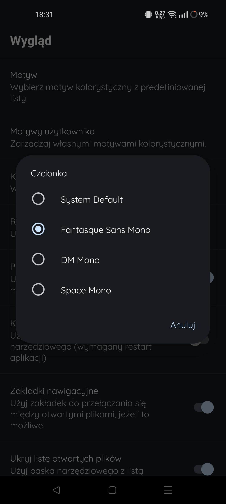
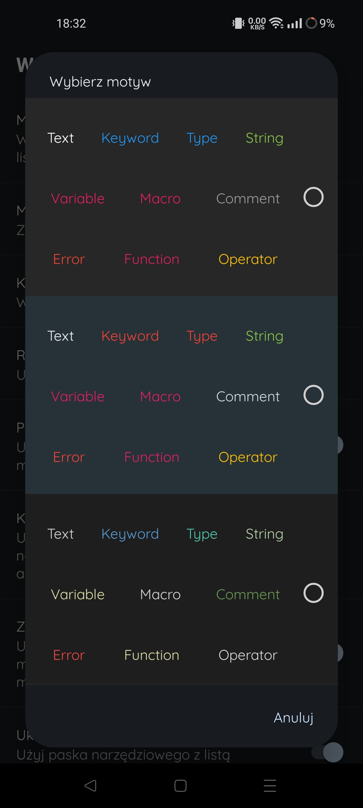
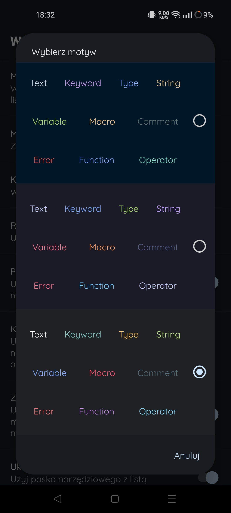
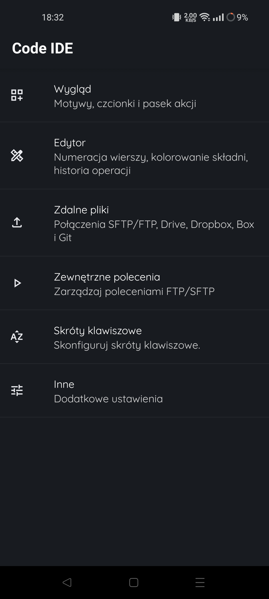
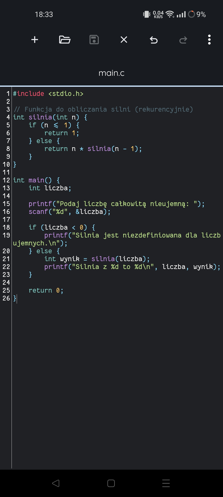
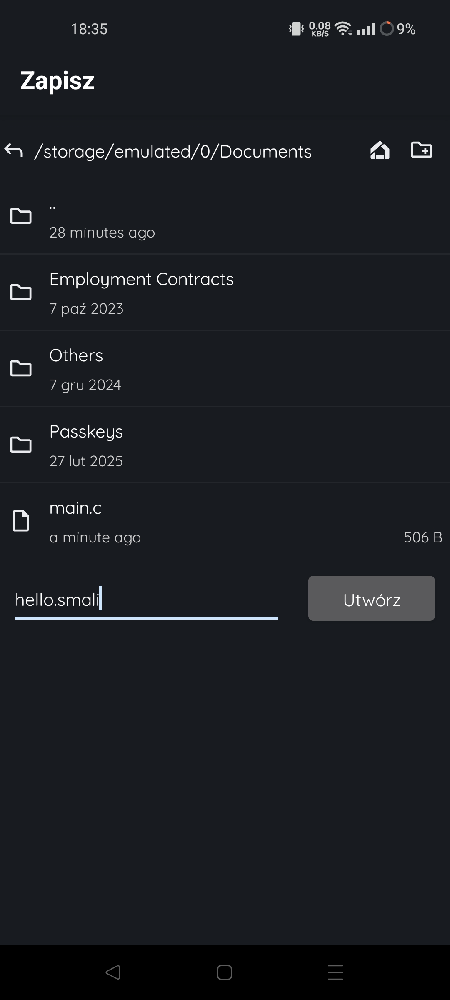
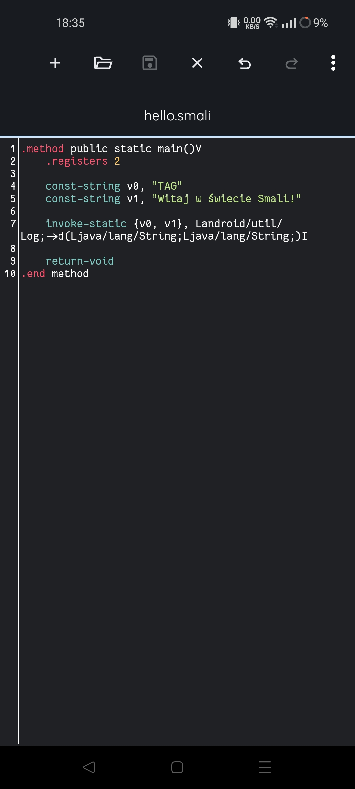
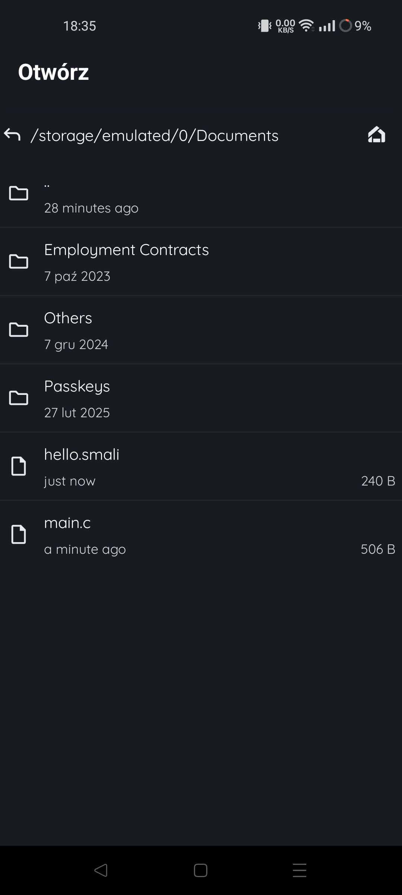
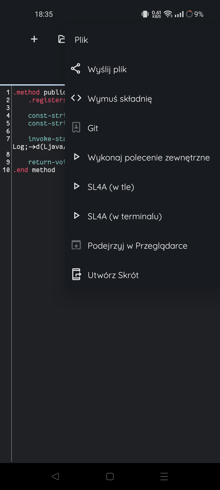
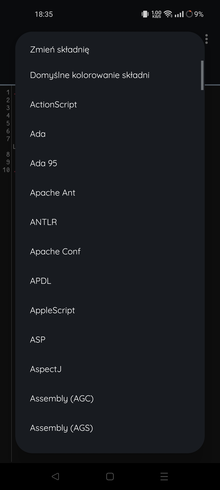
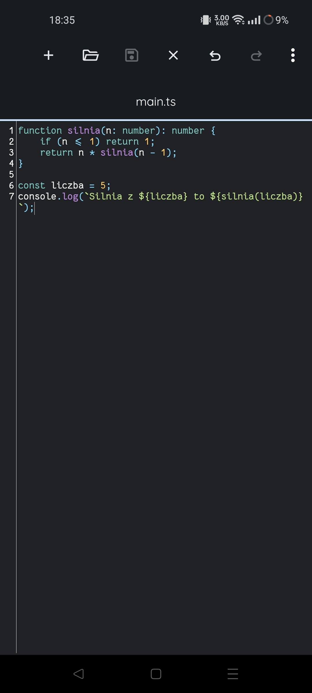
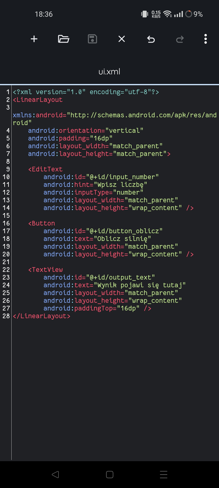
